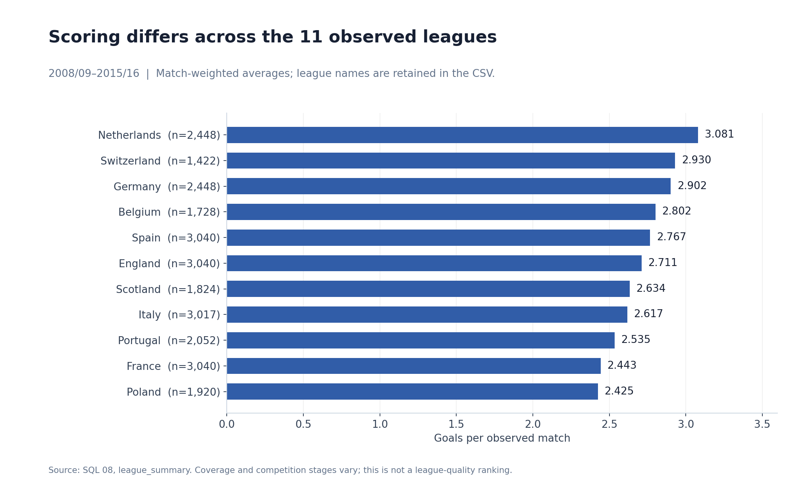
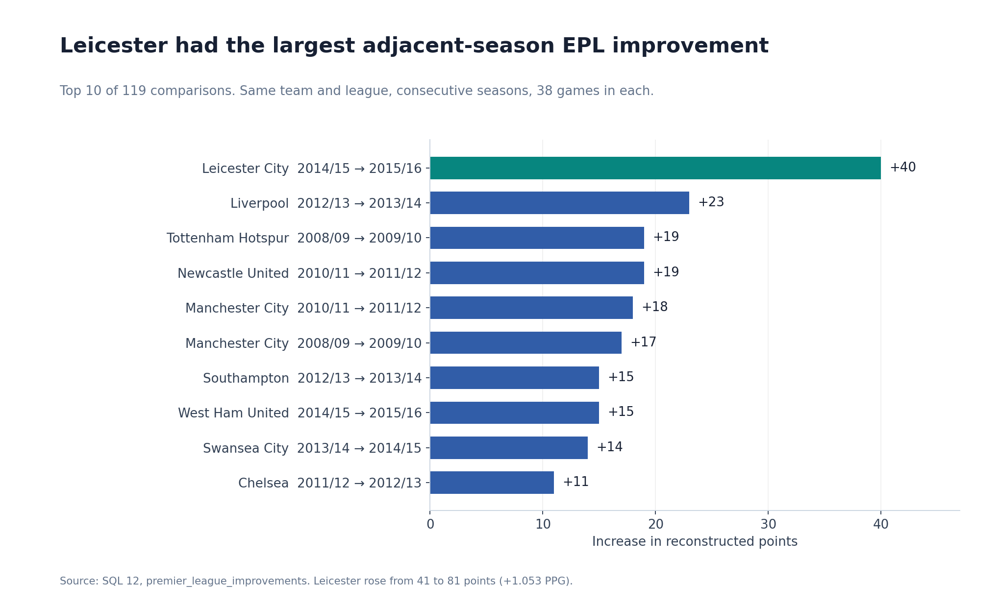
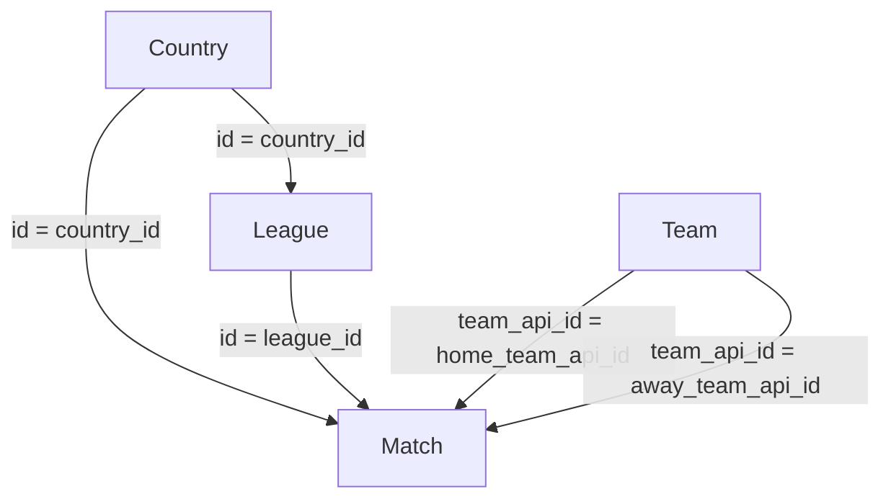

# SQL Soccer Game Analytics

A reproducible SQLite case study of **25,979 European league matches** across **11 countries** and **8 seasons (2008/09–2015/16)**. The project examines scoring, team performance, home/away results, and changes across consecutive seasons.

**Status:** core SQL analysis, complete result exports, reconciliation, six static figures and an interactive HTML dashboard are prepared. The Power BI project is packaged and structurally checked; native Power BI Desktop refresh and visual review are pending.

**Stack:** SQLite · SQL · Power BI/DAX · HTML/JavaScript · Python helpers for execution and verification.

## Explore the project

| Deliverable | Open |
| --- | --- |
| Interactive HTML dashboard | [HTML file](docs/index.html) — download/open locally, or use this repository's Website link after GitHub Pages is enabled |
| Editable Power BI report | [Power BI project](powerbi/SoccerAnalytics.pbip) — download the complete repository and retain the report/model folders |
| Power BI setup and limitations | [Vietnamese instructions](powerbi/README_VI.md) |
| SQL workflow | [All SQL statements](ALL_SOCCER_ANALYSIS.sql) or the ordered [SQL folder](sql/) |
| Complete data outputs | [38-table result index](outputs/results/RESULT_INDEX.md) |
| Interpretation | [Vietnamese analysis report](docs/BAO_CAO_KET_QUA.md) |
| Repository publishing guide | [Step-by-step GitHub setup](docs/HUONG_DAN_GITHUB.md) |

The HTML dashboard and Power BI queries contain the same verified output snapshot as `outputs/results/all_results.json`. Opening either dashboard does not rerun SQLite. GitHub displays the HTML source; a live interactive version requires GitHub Pages or opening the downloaded file in a browser.

## Five findings

1. The observed matches contain **70,287 goals**, or **2.706 goals per match**. Home wins account for **45.87%**, draws **25.39%**, and away wins **28.74%**. The home–away win-rate gap is **17.13 percentage points**.
2. **Netherlands Eredivisie** has the highest observed scoring average: **3.081 goals per match** across 2,448 fixtures. **Poland Ekstraklasa** has the lowest across all 11 observed leagues: **2.425**. Coverage and competition stages differ.
3. **Leicester City** leads the reconstructed 2015/16 Premier League PPG table with **81 points in 38 games (2.132 PPG)**: 23 wins, 12 draws, 3 losses.
4. **Manchester United 2010/11** has the largest home–away PPG difference among 160 Premier League team-seasons: **2.895 vs 1.316**, a **1.579 PPG** gap, with 19 matches at each venue.
5. **Leicester City 2014/15 to 2015/16** has the largest increase among 119 consecutive-season Premier League comparisons: **41 to 81 points**, or **+1.053 PPG**. It also leads the 578 adjacent-season comparisons in the five-league schedule-balanced sample.





These are historical descriptive findings. The project does not estimate causal home advantage or adjust cross-league results for opponent strength.

## Questions and evidence

| Question | SQL | Complete output |
| --- | --- | --- |
| How does scoring differ across leagues? | [08](sql/08_overview_and_leagues.sql) | [11 leagues](outputs/results/league_summary.csv) |
| How do result rates change by season? | [09](sql/09_season_trends.sql) | [88 league-seasons](outputs/results/league_season.csv) |
| Which teams lead within each league-season? | [10](sql/10_team_rankings.sql) | [1,481 team-seasons](outputs/results/team_season_rankings.csv) |
| How do home and away PPG compare? | [11](sql/11_home_away.sql) | [1,481 venue comparisons](outputs/results/team_home_away.csv) |
| Which teams improve between adjacent seasons? | [12](sql/12_consecutive_season_changes.sql) | [1,110 comparisons](outputs/results/consecutive_season_changes.csv) |

All **38 result tables**, including schema and quality audits, are listed in the [result index](outputs/results/RESULT_INDEX.md). Read the [Vietnamese final report](docs/BAO_CAO_KET_QUA.md) for interpretation and step-by-step instructions. An [Excel snapshot](outputs/SOCCER_RESULTS.xlsx) combines the main results for review.

## Source and grain

User-supplied SQLite file from [European Soccer Database by Hugo Mathien on Kaggle](https://www.kaggle.com/datasets/hugomathien/soccer). Original Kaggle version/download date was not supplied. Source SHA-256:

`4df8569777d59fdd690754b1cc8ca1f7989baf65f2eaddd0f1368285f11139a9`

The seven tables contain 25,979 matches, 299 teams, 11,060 players, 183,978 player-attribute rows and 1,458 team-attribute rows, plus 11 countries and 11 leagues. Match dates span 2008-07-18 to 2016-05-25. The [data dictionary](docs/DATA_DICTIONARY.md) describes all 199 columns.



- `v_matches`: one accepted match per row, **25,979 rows**.
- `v_team_matches`: two team perspectives per match via `UNION ALL`, **51,958 rows**.
- `v_team_season`: one team × league × season, **1,481 rows**.
- `v_league_season`: one league × season, **88 rows**.
- `v_team_season_change`: same team and league, adjacent start-years only, **1,110 rows**.

## Method

Join matches to countries, leagues and teams with their API keys. Reconstruct points using **3 for a win, 1 for a draw and 0 for a loss**. Divide by observed games to calculate PPG. Use conditional aggregation for venue metrics, `DENSE_RANK()` for PPG ranks within a league-season, and `LAG()` followed by a one-year gap check for changes across seasons. Ratios remain unrounded during calculations and ranking.

All analytical views are **TEMP**. The runner opens the source in read-only mode, uses one connection and verifies that the source fingerprint is unchanged.

## Coverage decisions

All matches pass the implemented core key, score and date checks, but league-season coverage needs separate interpretation.

| Slice | Observed matches | Concern |
| --- | ---: | --- |
| Belgium 2013/14 | 12 | Only 4 observed teams; narrow subset |
| Italy 2011/12 | 358 | 34–38 matches per observed team |
| Italy 2014/15 | 379 | 37–38 matches per observed team |
| Switzerland 2011/12 | 162 | 18–34 matches per observed team |

The comparison sample in SQL 07 includes **England, France, Germany, Netherlands and Spain**: **14,016 matches across 40 league-seasons**. Every ordered team pair occurs once within each observed season. This is an internal structural check, not independent proof of official full-season completeness. All-league outputs retain coverage notes, and the report emphasizes the balanced Premier League sample for team examples.

## Reproduce

Requirements: Python 3 with SQLite **3.25+** for window functions. SQL was executed with SQLite **3.53.1**. The analysis and independent verification use only Python's standard library. The SQL also runs in DB Browser for SQLite without Python.

1. Put the original file at `data/database.sqlite`. Raw data is excluded from Git.
2. From the project root, run:

```bash
python scripts/run_analysis.py --db data/database.sqlite
python scripts/verify_results.py --db data/database.sqlite
```

3. To regenerate the six charts with Matplotlib available:

```bash
python scripts/make_charts.py
```

For the GUI workflow, open the database and use [ALL_SOCCER_ANALYSIS.sql](ALL_SOCCER_ANALYSIS.sql). Run inspection queries separately to see each result. Execute all of SQL 03 and 07 before their dependent queries, in the same connection. TEMP views disappear when the connection closes. Running all SELECT statements together may display only the last result set; the Python runner exports every table automatically.

The XLSX is a review snapshot. It has formula-based rates/PPG, but SQL ranks and selected rows are stored results. Refresh SQL/CSV when changing the source; the XLSX does not run SQL automatically. CSV/JSON and regenerated charts are the reproducible pipeline outputs.

## Validation

**52 SQL statements executed; 22/22 SQL reconciliation checks passed.** Source integrity check returned `ok`; SHA-256 was unchanged. The checks reconcile goals, team rows, match outcomes, reconstructed points, aggregation keys, and consecutive-season conditions.

Independent accumulation directly from raw `Match` records reproduces **all 1,481 team-seasons**, **88 league-seasons**, and **1,110 consecutive-season changes**, using exact fractions to verify PPG ranks and changes. See [run metadata](outputs/results/run_metadata.json) and [independent verification](outputs/results/independent_verification.json).

## Files

| Path | Purpose |
| --- | --- |
| `ALL_SOCCER_ANALYSIS.sql` | Single file containing the entire SQL workflow |
| `sql/00`–`sql/06` | Schema, core quality, coverage, base views, initial query and extension audit |
| `sql/07`–`sql/13` | Aggregate views, final analyses and reconciliation |
| `scripts/run_analysis.py` | Execute all SQL and export complete CSV/JSON results |
| `scripts/verify_results.py` | Independently reconcile aggregates to raw match records |
| `scripts/make_charts.py` | Recreate six PNG/SVG charts from SQL outputs |
| `docs/` | Final Vietnamese report, learning roadmap and database documentation |
| `docs/index.html` | Self-contained HTML dashboard and GitHub Pages entry point |
| `powerbi/` | Five-page PBIP report, semantic model, 44 DAX measures and embedded query-result snapshot |
| `outputs/results/` | Complete query results and verification evidence |
| `outputs/SOCCER_RESULTS.xlsx` | Convenient review snapshot with five worksheets |
| `assets/` | Six figures in PNG and SVG format |

## Dashboard validation and refresh boundaries

The Power BI report preserves team identity using `team_api_id`. Where multiple IDs share a display name, its report label appends the ID; original `SQL_` result tables remain unchanged. League/season/team dimensions use one-way relationships to the three analytical fact tables. Measures recompute weighted ratios from numerator and denominator totals. SQL ranks remain within the original league-season.

Power BI packaging passed 88 public JSON-schema file checks and 29 data/structure checks. These are not native Desktop execution tests: DAX/Power Query engine execution and visual rendering must still be reviewed in Power BI Desktop. See [validation evidence](powerbi/docs/validation.json) and the [Desktop review checklist](docs/DASHBOARD_REVIEW.md).

The SQL runner regenerates CSV/JSON; `scripts/make_charts.py` regenerates the figures. The Excel workbook, HTML dashboard and embedded Power BI data are separate snapshots and do not update automatically when the SQLite source changes. The Power BI builder recreates a project from a provided dashboard snapshot; it does not query SQLite.

## Limitations and extensions

PPG ranks and reconstructed points are not official final standings: deductions, tie-break rules and stage-specific scoring are not applied. For example, Manchester City and Manchester United share the 2011/12 PPG lead in this method. Cross-league per-game metrics do not remove schedule, opponent or stage differences.

FIFA attributes, event XML, betting odds and machine learning are outside the completed core analysis. Their audits identify repeated entity-date keys, uneven coverage, empty XML and unverified odds timing. A future extension should resolve those issues, define temporal joins without future information, and validate event meanings before modeling. No predictive performance is claimed.

## SQL skills demonstrated

Schema inspection, data profiling, multi-table joins, CTEs, conditional aggregation, `UNION ALL`, analytical views, `DENSE_RANK`, `LAG`, denominator-aware metrics, coverage assessment, and reproducible data reconciliation.
