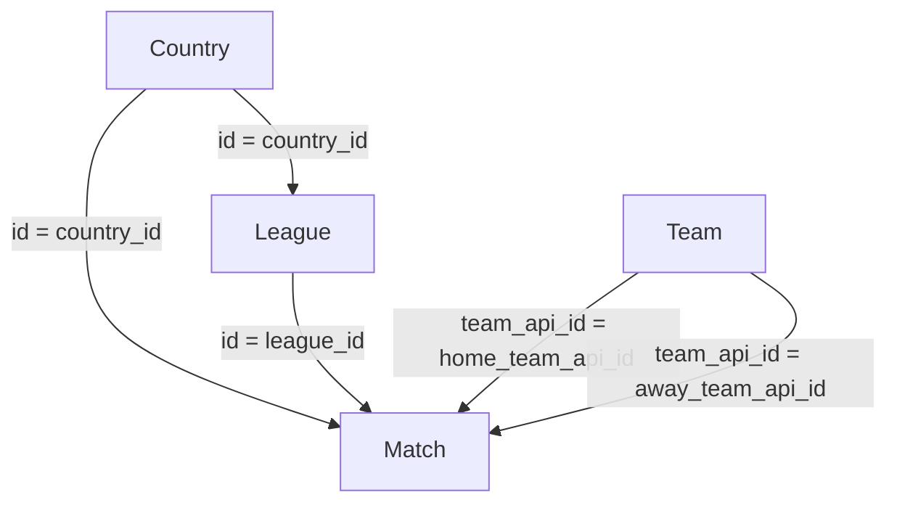

# Lộ trình SQL Soccer Game Analytics — cập nhật theo database thực tế

Đã đọc và kiểm tra database.sqlite bạn gửi. Dự án có thể bắt đầu với phân tích kết quả trận đấu ngay; cần đưa bước kiểm tra độ bao phủ giải–mùa vào trước các bảng so sánh.

## 1. Phạm vi dự án và đầu ra

Tên repository: sql-soccer-game-analytics. Bối cảnh mô phỏng: Data Analyst hỗ trợ một nhóm phân tích hoặc biên tập thể thao hiểu hiệu suất đội bóng và khác biệt sân nhà/sân khách.

Phạm vi tổng thể: 11 giải, 25.979 trận, 8 mùa 2008/2009–2015/2016. Mẫu thực hành đầu tiên: England Premier League, league_id=1729, 3.040 trận. Mỗi mùa có 20 đội và 380 trận; từng đội có 38 trận, đủ mỗi cặp sân nhà–sân khách trong tập quan sát.

Sản phẩm cuối cùng: README tiếng Anh, data dictionary, sơ đồ quan hệ, SQL có comment theo từng câu hỏi, kết quả tổng hợp, 4–6 biểu đồ và 3–5 kết luận có bằng chứng. Đã hoàn thành phân tích chính, 6 biểu đồ và báo cáo tổng hợp. Xem docs/BAO_CAO_KET_QUA.md và README.md để đọc kết quả cuối cùng; repository chưa được xuất bản.

## 2. Những điều quy trình cần phản ánh

- Các trường lõi về mã trận, giải, đội, mùa, ngày và tỷ số không có NULL; match_api_id không trùng. Giữ 25.979 trận ở lớp dữ liệu kết quả ban đầu.
- Belgium 2013/2014 chỉ có 12 trận của 4 đội. Italy 2011/2012 có 358 trận và Italy 2014/2015 có 379 trận, dù cùng quan sát 20 đội. Gắn cờ để xác minh trước khi đại diện cho mùa đầy đủ.
- So sánh số trận hoặc điểm tổng giữa các giải cần kiểm tra thể thức và coverage. Một mô hình hai lượt không phù hợp với mọi giải; độ cân bằng nội bộ chưa chứng minh thu thập đủ các giai đoạn.
- Chỉ số FIFA có nhiều dòng theo thời gian, có khóa cầu thủ–ngày hoặc đội–ngày trùng; JOIN theo mã đơn thuần có thể nhân dòng.
- Event XML có thể không NULL nhưng rỗng. Ví dụ possession chỉ có phần tử con ở 8.419 trận, so với 14.217 ô không NULL. Phân tích XML/odds là nhánh mở rộng.

## 3. Hiểu cấu trúc trước khi JOIN

| Table | Rows | Columns |
| --- | --- | --- |
| Country | 11 | 2 |
| League | 11 | 3 |
| Match | 25979 | 115 |
| Player | 11060 | 7 |
| Player_Attributes | 183978 | 42 |
| Team | 299 | 5 |
| Team_Attributes | 1458 | 25 |

Match có 115 cột: 11 cột định danh/thời gian/kết quả, 22 mã cầu thủ, 44 tọa độ, 8 trường XML và 30 trường odds. Phiên bản đầu chỉ cần nhóm lõi và tên đội/giải/quốc gia.




| Cột nguồn | Cột đích | Cách sử dụng |
| --- | --- | --- |
| League.country_id | Country.id | Quốc gia của giải. |
| Match.league_id | League.id | Tên giải; không dùng country_id thay thế league_id. |
| Match.country_id | Country.id | Tên quốc gia của trận. |
| Match.home_team_api_id | Team.team_api_id | JOIN Team với alias home. |
| Match.away_team_api_id | Team.team_api_id | JOIN Team với alias away. |
| Match.home_player_1…11 / away_player_1…11 | Player.player_api_id | 22 vị trí cầu thủ, có thể thiếu. |
| Player_Attributes.player_api_id | Player.player_api_id | Nhiều lần ghi nhận theo cầu thủ. |
| Team_Attributes.team_api_id | Team.team_api_id | Nhiều lần ghi nhận theo đội. |

Không tự JOIN Match.home_team_api_id với Team.id. Mã API và mã nội bộ là các hệ định danh khác nhau. Team không có cột country_id; muốn xác định các giải/quốc gia đội xuất hiện, đi qua Match. Player cũng không có quan hệ đội bóng cố định trong bảng Player; đội hình trận đấu là một nguồn quan hệ theo thời điểm.

## 4. Quy trình thực hiện theo từng buổi

Các buổi dưới đây là mốc học tập, có thể chia nhỏ theo thời gian của bạn.

| Buổi | Việc làm | File / đầu ra | Điều kiện hoàn thành |
| --- | --- | --- | --- |
| 1. Mở và hiểu dữ liệu | Đọc bảng, khóa, kiểu dữ liệu và số dòng. | SQL 00; docs/DATA_DICTIONARY.md. | Giải thích được một dòng Match và một dòng Player_Attributes khác nhau thế nào. |
| 2. Chất lượng và coverage | Chạy kiểm tra NULL, trùng, quan hệ; xem 88 tổ hợp giải–mùa. | SQL 01–02; docs/DATABASE_PROFILE.md. | Hiểu vì sao có tỷ số đầy đủ vẫn cần kiểm tra mẫu theo mùa. |
| 3. Chuẩn bị dữ liệu | Đọc cách JOIN tên hai đội và UNION ALL tạo góc nhìn đội–trận. | SQL 03. | v_matches có 25.979 dòng; v_team_matches có 51.958 dòng. |
| 4. Đối chiếu và câu hỏi đầu tiên | Chạy 10 kiểm tra; tính số trận, bàn/trận và tỷ lệ kết quả Premier League theo mùa. | SQL 04–05; outputs/FIRST_ANALYSIS.md. | Các kiểm tra passed=1; kết quả có 8 dòng, 380 trận mỗi mùa. |
| 5. Hiệu suất đội bóng | Tự viết tổng hợp điểm, bàn thắng/thua, PPG theo đội–giải–mùa; thêm DENSE_RANK. | SQL 07 và 10; outputs/results/team_season_rankings.csv. | Số thắng+hòa+thua bằng số trận; giải thích được việc đồng hạng theo chỉ số. |
| 6. Sân nhà và thay đổi qua mùa | Tính chênh lệch PPG sân nhà/sân khách; LAG theo đội và giải. | SQL 11–12; outputs/results/. | LAG chỉ diễn giải là thay đổi năm liền trước khi hai mùa thực sự liên tiếp. |
| 7. Mở rộng giải và kể câu chuyện | Chọn mẫu theo coverage; so sánh chỉ số mỗi trận; tạo 4–6 biểu đồ. | Biểu đồ và 3–5 kết luận. | Mỗi kết luận có con số, mẫu số, thời gian, SQL hỗ trợ và giới hạn. |
| 8. Hoàn thiện GitHub | Biên tập README tiếng Anh, hướng dẫn chạy, nguồn, ảnh và giới hạn. | Repository portfolio. | Người khác có thể lấy dữ liệu, chạy lại và đọc được câu chuyện phân tích. |

## 5. Câu hỏi phân tích chính

| Câu hỏi | Dữ liệu / kỹ năng | Cách diễn giải |
| --- | --- | --- |
| Số bàn mỗi trận và tỷ lệ thắng sân nhà thay đổi thế nào qua mùa ở Premier League? | v_matches; GROUP BY, CASE WHEN, AVG. | Bắt đầu với SQL 05 đã có kết quả đối chiếu. |
| Đội nào đạt PPG cao nhất trong một giải–mùa? | v_team_matches; GROUP BY, CTE, DENSE_RANK. | Xếp hạng theo KPI, không tự gọi là bảng xếp hạng chính thức. |
| Đội nào chênh lệch PPG sân nhà/sân khách lớn nhất? | Tổng hợp có điều kiện theo đội–giải–mùa. | Tính riêng mẫu số mỗi sân; báo cáo số trận cả hai bên. |
| Đội nào cải thiện qua hai mùa liên tiếp trong cùng giải? | LAG theo team_api_id và league_id. | Kiểm tra năm; không nhầm lần xuất hiện trước với mùa liền trước. |
| Các giải khác nhau thế nào về bàn/trận và tỷ lệ kết quả? | Mở rộng mẫu sau SQL 02; nhóm theo league_id,season. | Gắn cờ coverage và dùng chỉ số mỗi trận; khác biệt mô tả chưa chứng minh quan hệ nhân quả. |

## 6. KPI và mẫu số

| KPI | Công thức | Lưu ý |
| --- | --- | --- |
| Goals per match | SUM(home_goals+away_goals) / số trận hợp lệ | Dùng AVG(total_goals) ở cấp trận. |
| Home win rate | Số trận chủ nhà thắng / tất cả trận hợp lệ | Mẫu số có cả hòa và khách thắng. |
| Away win rate | Số trận khách thắng / tất cả trận hợp lệ | Cùng tập trận với home win rate. |
| Home–away gap | Home win % − Away win % | Đơn vị điểm phần trăm; không phải phần trăm thay đổi. |
| Team points | 3×thắng + 1×hòa | Điểm tính từ quan sát, chưa phản ánh trừ điểm hay quy tắc giải. |
| Points per game | Tổng điểm đội / số trận đội | Dùng số thực: 1.0*SUM(points)/NULLIF(COUNT(*),0). |
| Goal difference per game | SUM(goals_for-goals_against) / số trận đội | So sánh theo đội–giải–mùa. |
| Home–away PPG gap | PPG sân nhà − PPG sân khách | Có mẫu số riêng mỗi sân; không chia cả hai bằng tổng số trận. |

Không làm tròn trước khi xếp hạng hoặc tính chênh lệch. Không so sánh tổng điểm của đội đá 38 trận với đội đá 34 trận mà bỏ qua số trận. Dùng PPG vẫn cần ghi nhận khác biệt đối thủ, giải và độ bao phủ.

## 7. Cách chạy trên máy bạn

1. Giải nén bộ mã nguồn sql-soccer-game-analytics.zip.
2. Đặt file database.sqlite của bạn trong thư mục data/ ở máy. Dùng Open Database trong [DB Browser for SQLite](https://sqlitebrowser.org/) để mở đúng file.
3. Trong Execute SQL, chạy từng câu của 00, 01 và 02; đọc kết quả cùng tài liệu tương ứng.
4. Chạy toàn bộ SQL 03 trong cùng kết nối. SQL này tạo hai TEMP view, không sửa bảng dữ liệu gốc.
5. Chạy SQL 04; mong đợi 10 dòng passed=1 và bảng số dòng 25.979 / 51.958.
6. Chạy SQL 05; so kết quả với outputs/FIRST_ANALYSIS.md. Có thể xuất bảng kết quả bằng chức năng Export của công cụ.
7. Chạy SQL 07 để tạo các view tổng hợp, sau đó SQL 08–12 để xem phân tích cuối cùng và SQL 13 để kiểm tra 12 đối chiếu bổ sung.
8. Sau khi đóng/mở lại database, chạy lại SQL 03 và 07 trước các truy vấn phụ thuộc vì TEMP view đã hết hiệu lực.

Các truy vấn đã chạy trên SQLite 3.53.1. Dạng hàm bảng PRAGMA cần SQLite 3.16.0 trở lên; window functions trong SQL 07 cần SQLite 3.25 trở lên. Có thể chạy toàn bộ SQL trong DB Browser mà không cài Python. Script Python tùy chọn giúp xuất đồng thời 38 bảng CSV, kiểm tra độc lập và vẽ lại biểu đồ.

## 8. Bài thực hành đầu tiên nên tự làm

Chạy truy vấn dưới đây và kiểm tra bạn có 8 dòng, mỗi dòng 380 trận:

```sql
SELECT season,
       COUNT(*) AS total_matches,
       ROUND(AVG(home_team_goal + away_team_goal), 3) AS goals_per_match
FROM "Match"
WHERE league_id = 1729
GROUP BY season
ORDER BY season;
```

Cách đọc: WHERE chọn Premier League; GROUP BY gom trận theo mùa; COUNT đếm trận; AVG tính tổng bàn trung bình của hai đội; ROUND chỉ phục vụ hiển thị. Ở bản dữ liệu đã kiểm tra, không có tỷ số thiếu nên AVG dùng đủ mọi trận trong từng mùa.

Một mốc đối chiếu: mùa 2015/2016 có 380 trận, 1.026 bàn, tương đương 2,700 bàn/trận. Đây là mốc kiểm tra bài thực hành đầu tiên; toàn bộ kết luận của dự án nằm trong docs/BAO_CAO_KET_QUA.md.

## 9. Hướng mở rộng sau phiên bản đầu

Player_Attributes: thống nhất cách xử lý trùng player_api_id–date trước khi chọn snapshot gần nhất không sau thời điểm trận. Giữ thiếu nếu chưa có snapshot quá khứ; không bù bằng dữ liệu tương lai. Nếu timestamp chỉ có ngày hoặc giờ mặc định, cần nói rõ cách xử lý bản ghi cùng ngày và độ cũ tối đa chấp nhận.

Team_Attributes: chỉ có 6 ngày ghi nhận, bao phủ 288/299 mã đội; có nhóm đội–ngày trùng. Các trường này mô tả nhiều khía cạnh phong cách chơi; bảng không có overall_rating của đội.

XML: chuyển từng loại sự kiện sang bảng có cấu trúc riêng trước khi tính toán. Xác nhận quan hệ giữa bản ghi XML, thời điểm và match_api_id; phân biệt thiếu dữ liệu, XML rỗng và số lượng sự kiện bằng 0.

Odds: chọn một bộ H/D/A có đủ dữ liệu, kiểm tra odds hợp lệ và thời điểm ghi nhận. Nếu đánh giá xác suất, xác định cách chuẩn hóa phần biên nhà cái và tách mẫu theo thời gian. Không suy ra đây là odds trước trận hoặc odds đóng cửa khi chưa xác minh nguồn.

## 10. Đưa dự án lên GitHub

README tiếng Anh đã hoàn thiện với mục tiêu, nguồn, phương pháp, kết quả, biểu đồ, giới hạn và cách chạy. Đọc lại và bổ sung thông tin tác giả của bạn trước khi xuất bản.

Giữ database ở máy; bộ mã nguồn chỉ chứa SQL, tài liệu và kết quả tổng hợp. data/README.md có hướng dẫn nguồn và .gitignore loại file dữ liệu thô. File SQLite đã giải nén khoảng 298,59 MiB; GitHub chặn file trên 100 MiB trong Git thông thường, theo [hướng dẫn chính thức](https://docs.github.com/en/repositories/working-with-files/managing-large-files/about-large-files-on-github).

Phần phân tích, biểu đồ, tài liệu và kiểm tra chạy lại đã hoàn tất. Hiện chưa tạo hoặc xuất bản repository thay bạn; bạn có thể đưa bộ mã nguồn đã chuẩn bị lên repository của mình.
